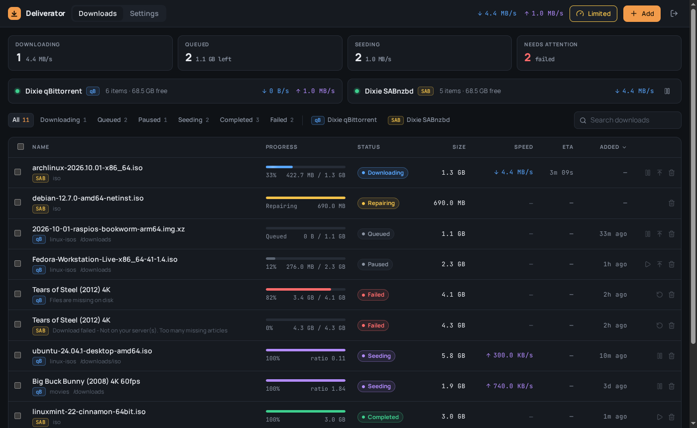
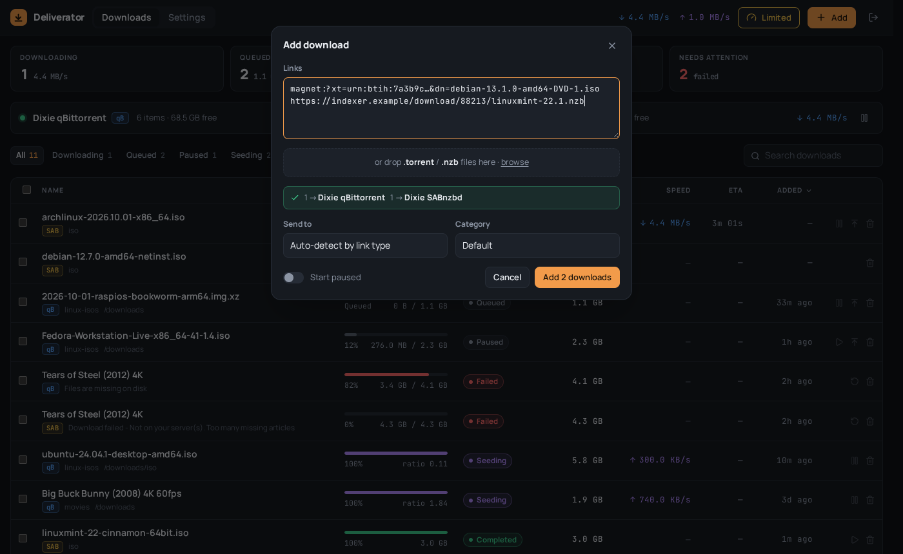
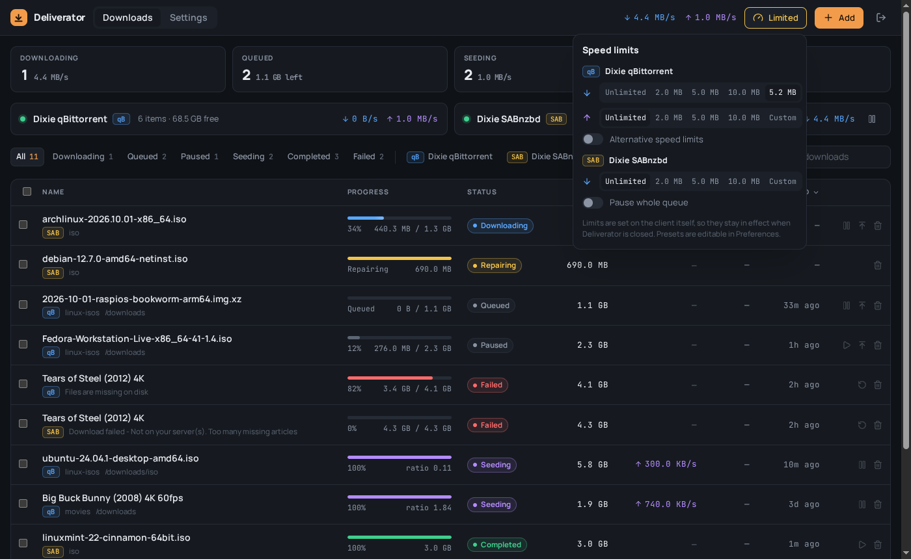
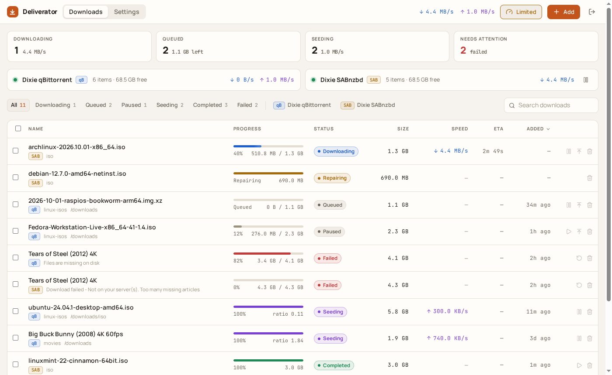
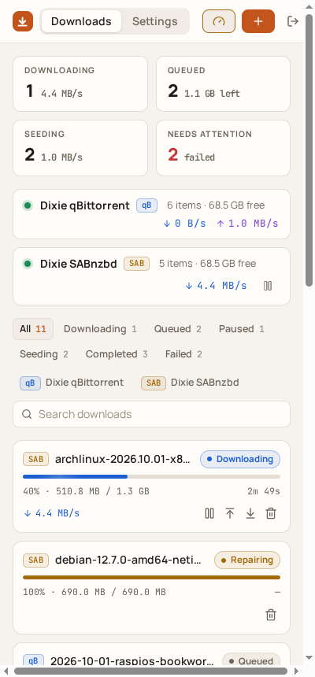

<p align="center">
  
</p>
<h1 align="center">Deliverator</h1>
<p align="center">One simple web UI for your download clients. qBittorrent and SABnzbd today, more to come.</p>

<p align="center">
  
</p>

Deliverator shows every download from every client in a single list and gives you the handful of
controls you actually use day to day: add, pause, resume, delete, reorder, throttle. The deep
settings of each client stay where they are. If you need them once a year, open the client's own UI.

It is inspired by [qbitwebui](https://github.com/mkbula/qbitwebui) and built for a homelab: one small
Docker container, SQLite, no external services, happy behind a reverse proxy on a sub-path.

## Features

- **One list, many clients.** Torrents and NZBs side by side with the same columns, filters and
  actions. Each client is a *provider*; add as many as you like.
- **The frequent stuff only.** Add by magnet, URL or file (drag and drop), pause/resume, delete with
  or without files, move to top/bottom, retry failed, set category, bulk select.
- **Throttle in two clicks.** Per-provider download/upload limits with your own presets, qBittorrent's
  alternative limits toggle, SABnzbd queue pause. Limits are set on the client itself, so they stick.
- **Live.** The server polls each client and pushes updates to the browser over Server-Sent Events.
  Progress bars move, speeds tick, nothing to refresh.
- **Works on a phone.** The table turns into cards. Install it to your home screen if you like.
- **Themes.** Midnight, Graphite, Nord, Forest, Paper, Daylight, or follow the system. Adding one is a
  single entry in `packages/client/src/theme/themes.ts`.
- **Sub-path hosting.** Set `BASE_PATH=/downloader` and everything (assets, API, cookies, router)
  lives under it.
- **Single admin user.** A random password is printed to the console on first start. Change it in
  Settings, or reset it with one command if you lose it.

<p align="center">
  
  
</p>
<p align="center">
  
  
</p>

## Quick start (Docker)

```yaml
# docker-compose.yml
services:
  deliverator:
    image: ghcr.io/alexstansfield/deliverator:latest
    container_name: deliverator
    restart: unless-stopped
    ports:
      - "3000:3000"
    volumes:
      - ./data:/data
```

```bash
docker compose up -d
docker compose logs deliverator   # the first-start password is printed here
```

Open <http://localhost:3000>, sign in as `admin`, then go to **Settings → Providers** and add your
qBittorrent (URL, username, password) or SABnzbd (URL, API key). Use the URL as seen from the
Deliverator container; with Docker that is usually the other container's name, not `localhost`.

### Configuration

All settings are environment variables. None are required.

| Variable | Default | What it does |
| --- | --- | --- |
| `PORT` | `3000` | Port to listen on |
| `HOST` | `0.0.0.0` | Interface to bind |
| `DATA_DIR` | `/data` (Docker) · `./data` | Where the SQLite database and secret key live |
| `BASE_PATH` | *(empty)* | Serve under a sub-path, e.g. `/downloader` |
| `SECRET_KEY` | *(generated)* | 64 hex chars. Encrypts provider credentials and signs sessions. Generated into `$DATA_DIR/secret.key` when unset |
| `ALLOW_SELF_SIGNED_CERTS` | `false` | Accept self-signed HTTPS certificates on providers |
| `POLL_INTERVAL_MS` | `2000` | How often each provider is polled |
| `LOG_LEVEL` | `info` | `debug`, `info`, `warn` or `error` |

### Reverse proxy on a sub-path

Set `BASE_PATH=/downloader` and proxy that prefix to the container **without stripping it**:

```nginx
location /downloader/ {
    proxy_pass http://deliverator:3000;
    proxy_http_version 1.1;
    proxy_set_header Host $host;
    proxy_set_header X-Forwarded-Proto $scheme;
    proxy_buffering off;   # keeps the live event stream flowing
}
```

Caddy: `handle /downloader/* { reverse_proxy deliverator:3000 }`. Traefik needs no path rewriting either.

### Forgot the password?

```bash
docker exec deliverator deliverator reset-password
```

A fresh random password is printed and every session is logged out.

## Running without Docker

Needs Node 22 and pnpm (`corepack enable`).

```bash
git clone https://github.com/AlexStansfield/deliverator.git
cd deliverator
pnpm install
pnpm build
DATA_DIR=./data pnpm start          # http://localhost:3000
pnpm --filter @deliverator/server cli reset-password   # password reset
```

## Development

```bash
pnpm install
pnpm --filter @deliverator/server mock   # fake qBittorrent (:18080) and SABnzbd (:18081) with moving data
pnpm dev                                  # API on :3000, Vite client on :5173 with proxy
pnpm test                                 # adapter and API tests against the mocks
pnpm typecheck
```

Add the mocks in Settings as `http://localhost:18080` (admin / adminadmin) and `http://localhost:18081`
(API key `mock-api-key`).

### Layout

```
packages/shared   types shared by server and client (the Download model, API shapes, formatting)
packages/server   Hono API, SQLite via Drizzle, provider adapters, poller, SSE, CLI
packages/client   React + Vite + Tailwind UI
docs/mockup       the original HTML design mockup
```

### Adding a provider

1. Implement `ProviderAdapter` from `packages/server/src/providers/types.ts`. Have a look at
   `sabnzbd.ts`, it is about 250 lines.
2. Add the type to `PROVIDER_TYPES` in `packages/shared/src/providers.ts` and register it in
   `packages/server/src/providers/registry.ts` with its capabilities.
3. Add a tag colour in `packages/client/src/components/downloads/bits.tsx` and credential fields in
   the providers settings form.
4. Add a mock under `packages/server/src/mock/` and tests next to the adapter.

Capabilities drive the UI: if a client cannot limit upload speed or reorder its queue, those controls
simply do not appear for it.

## Contributing

Suggestions, bug reports and pull requests are all welcome. Open an issue to discuss bigger changes
first so nobody wastes an evening.

This project is written almost entirely with AI coding tools (Claude Code), reviewed and directed by a
human. That is a feature of how it is built, not an excuse for bugs. If something is wrong, say so.

## License

[MIT](LICENSE)
